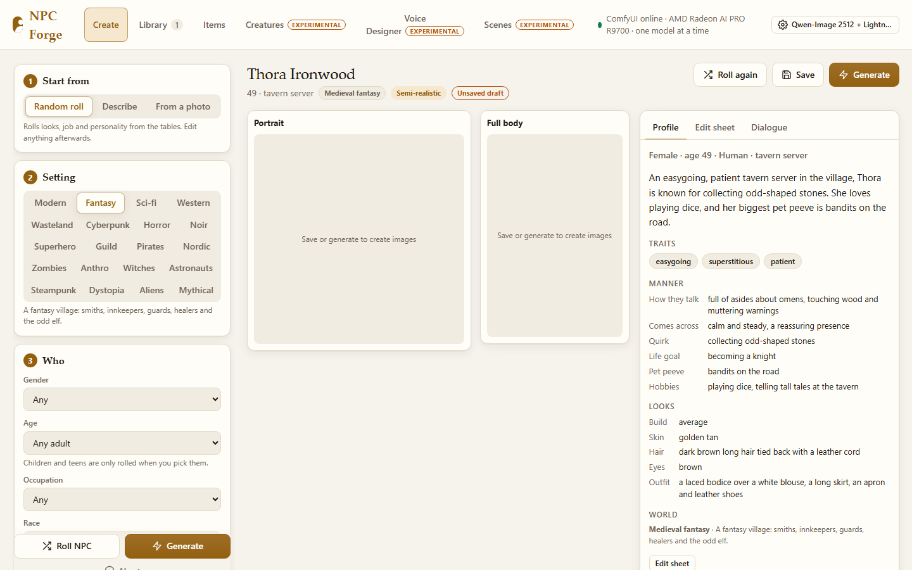

# Fel's NPC Forge

A local character generator for games. Roll a character, describe one in a sentence, or import a cast list, and NPC Forge
makes a data sheet with a personality, a portrait, expressions, a transparent full-body sprite, **walk cycles ready for your
engine**, a **model sheet** (a turnaround for 3D work), a **rigged 3D model**, items for them to hold and wear, and (experimental)
a voice. Everything is drawn by models running in your own ComfyUI. There is no cloud and nothing to train: a web app and a
command line on your own PC.




## What it makes

| | |
|---|---|
| **Characters** | 20 settings (modern, fantasy, sci-fi, Old West, cyberpunk, pirates, steampunk, mythical creatures…), 632 occupations with outfits, a personality and a bio, editable field by field with locks |
| **Pictures** | Portraits, expressions, transparent full-body sprites and model sheets in 17 art styles, from pixel art to photorealistic |
| **Animation** | 4-direction walk cycles (and experimental run, attack, hurt, cast and fall clips), exported for Godot 4, Unity, Aseprite or a plain atlas |
| **3D** | A 3D model from the model sheet (Trellis2, Pixal3D or Hunyuan3D in ComfyUI), cleaned up and painted, with a skeleton and 85 animation clips (Blender) |
| **Items** | Weapons, armour, hats, shoes, bags and props as game-ready 3D models, and procedural glasses fitted to a face |
| **Licences** | Every picture, model and voice is tagged with what its models allow: free for commercial use, conditional, unclear or non-commercial |

**Experimental** (marked in the app): the **Voice Designer** (a voice for every character, dialogue and lip sync), **Scenes**
(two or more characters acting out a scene) and **Creatures** (non-humanoid creatures for a game). They work, but have been
checked on fewer characters than the rest; see [Status](#status-what-has-and-has-not-been-checked).

## What you need

- **A GPU with about 32 GB of VRAM and 64 GB of RAM** for the default picture engines (Qwen-Image 2512 and Qwen-Image-Edit 2511,
  Apache-2.0): a picture needs about 29 GB of free VRAM and 30 GB of free RAM. It was built and tested on an AMD Radeon AI PRO
  R9700 (32 GB) under Windows 11 with ROCm. Smaller cards can use the lighter built-in **Mage-Flow** engine instead (see
  [Models](#models-which-engine-draws-and-which-one-edits)), but read its licence note first: Microsoft released it for research.
- **[ComfyUI](https://github.com/comfyanonymous/ComfyUI) 0.36 or newer**, running at `http://127.0.0.1:8188`, with the model files
  listed under [Requirements](#requirements).
- **Python 3.10 or newer**.
- Optional: **Blender 5** (skeletons, clean-up and game models), **FFmpeg** (scene videos), **Godot 4** (to try the exports).

## Quick start

1. Start ComfyUI and check it answers at `http://127.0.0.1:8188`.
2. Get NPC Forge and install its few Python packages (Pillow, numpy, xatlas):
   ```bash
   git clone https://github.com/Fel101/fels-npc-forge.git
   cd fels-npc-forge
   setup.bat          # Windows; on Linux or macOS: ./setup.sh
   ```
3. Optional: copy `config.example.json` to `config.json` to change the ComfyUI address, the port or the default engines.
4. Start it: double-click `start.bat` (Windows), or run `python server.py --open`. The page opens at `http://127.0.0.1:8766`.
5. On the **Create** page press **Roll NPC**, tick what to make (a portrait is a good first try) and press **Generate**.
   The queue on the right shows each step; the finished character is in the **Library**.

**AI agents:** Claude Code, Codex, opencode and other MCP clients can make characters and export them for a game through
NPC Forge's MCP server (`npcgen/mcp.py`); [docs/agents.md](docs/agents.md) has the line to add to each. Scripts can use the
[HTTP API](docs/api.md).

**Updating:** *About* > **Check for updates** asks GitHub for a newer release (only when you press it), and **Update now**
shows what will change, closes NPC Forge, updates it and starts it again. Or close NPC Forge and run `update.bat` (`./update.sh`
on Linux or macOS): it shows the plan and asks first. Your library, `config.json`, `local` folder and `.venv` are never touched,
and `update.bat --undo` puts back the version the last update replaced. A `git clone` is moved forward to the release's tag; a
folder unpacked from a ZIP gets the release's files, with a copy of each file it replaces kept in `local\update`.

The status line at the top of the page says whether ComfyUI answers and which model files it lacks; `python -m npcgen health`
says the same on the command line. The rest of this README is the reference.

## Requirements

- A running ComfyUI (0.36 or newer) at `http://127.0.0.1:8188`.
- The files of the default engines, Qwen-Image 2512 and Qwen-Image-Edit 2511 with their 4-step Lightning LoRAs (about 30 GB of RAM and 29 GB of free VRAM while a picture is drawn): `diffusion_models/qwen_image_2512_fp8_e4m3fn.safetensors`, `diffusion_models/Qwen-Image-Edit-2511-FP8_e4m3fn.safetensors`, `text_encoders/qwen_2.5_vl_7b_fp8_scaled.safetensors`, `vae/qwen_image_vae.safetensors`, `loras/Qwen-Image-Lightning-4steps-V2.0.safetensors` and `loras/Qwen-Image-Edit-2511-Lightning-4steps-V1.0-bf16.safetensors`. Without them a picture fails and names what is missing; to use the lighter Mage-Flow instead, set `"options": {"image_model": "mage", "edit_model": "mage", "engine_fallback": true}` in `config.json` (or pick it in Models).
- Optional, the built-in Mage-Flow engine: these files in ComfyUI (from [Comfy-Org/Mage-Flow](https://huggingface.co/Comfy-Org/Mage-Flow)):
  `diffusion_models/mage_flow_int8_convrot.safetensors`, `diffusion_models/mage_flow_edit_int8_convrot.safetensors`,
  `text_encoders/qwen3vl_4b_bf16.safetensors`, `vae/mage_flow_vae_bf16.safetensors`.
  Other variants work if you name them in `config.json`. Every prompt, animation check and model sheet was first tuned on Mage-Flow.
- Optional, for the **Models** card (below): the files of any other engine you want to pick. ComfyUI's `/models` lists are
  checked, and an engine whose files are missing is shown as "not installed".
- For Hunyuan3D v2.1: its ComfyUI nodes and `hunyuan_3d_v2.1.safetensors` in the checkpoint list. For Pixal3D: ComfyUI's
  Pixal3D/TRELLIS2 and mesh-texturing nodes, plus `diffusion_models/pixal3d_multiview_int8_convrot.safetensors`,
  `clip_vision/dino_v3_L_naf_fp32.safetensors`, `vae/trellis_2_shape_vae_bf16.safetensors`,
  `vae/trellis_2_texture_vae_bf16.safetensors` and `background_removal/birefnet.safetensors`. NPC Forge's own two ComfyUI nodes are
  installed with `python scripts/install_pixal_head_node.py <ComfyUI folder> --trellis2`. The Models card checks local
  ComfyUI model lists and required node classes before a generator is selected.
- Python 3.10+ and `pip install -r requirements.txt` (Pillow, numpy and xatlas; the rest is the standard library).
- Optional **FFmpeg** on `PATH` for Scene maker MP4 export. Scene editing and preview work without it.

Read [NOTICE.md](NOTICE.md) first: it lists the licence of every model NPC Forge can use, including Microsoft's statement that
Mage-Flow is released for research and not intended for product or service deployment.

## Start

```bash
python server.py --open        # web app at http://127.0.0.1:8766   (or double-click start.bat on Windows)
python -m npcgen -h            # command line
```

Everything the page does goes through a local HTTP API, which a game's own scripts can use too: [docs/api.md](docs/api.md) lists
every route, and [docs/game-clients.md](docs/game-clients.md) says how to run a bulk job from a script.

## Three ways to make a character

1. **Roll**: a weighted random person from the tables in `data/` (modern, fantasy, sci-fi, Old West, post-apocalypse,
   cyberpunk, gothic horror, noir detective, superhero, adventurers'-guild, pirate, Nordic saga, zombie-outbreak,
   anthro, witches-and-warlocks, space-program, steampunk, dystopian-state, alien-species and mythical-creature settings,
   632 occupations with outfits). Edit any field and lock the ones you want to keep when you roll again.
2. **Describe**: "a tiny robot chef with a copper teapot head, riveted brass apron and glowing blue eyes". Your words are
   the art prompt. Anything goes: people, robots, creatures. If your words about a person do not say a woman or a man, the
   Who card's Gender leads them ("a female character, ..."), so the picture follows the card; words that say it win, and
   robots and creatures are left alone.
3. **Cast file**: import JSON or CSV. Give any subset of fields (`name`, `age`, `gender`, `job`, `hair`, `outfit`,
   `description`...) and the rest is rolled. Columns we do not recognise travel untouched in `npc.json` under `custom`, so
   your game's own data (schedules, stats, ids) stays attached to the character. An empty cell means "roll it"; write `none`
   in `accessory`, `beard`, `glasses` or `distinguishing` to rule a random one out. A small Old West cast to try is in
   [examples/frontier_town_cast.json](examples/frontier_town_cast.json).

In the Library, select NPCs and choose **Create from selected** to group them into a cast pack, or use **Import as pack**
to create the NPCs and pack together. Packs can record a roster type (party, guild, town or ship crew), shared context,
member roles and notes, optional distinct-role validation, uniqueness-rule guidance, relationship links, rumors and plot hooks.
**Suggest roles** fills blank roles from the selected roster type. Enable **Require a different role for each member** to
reject duplicate named roles on save, ignoring capitalization. Free-text uniqueness notes remain guidance and do not
change NPC generation or validate profile data. Export a pack to get one ZIP
with `cast-pack.json` plus a folder and `npc.json` for each member; NPC custom fields stay in those individual records.
The existing **Import cast** action still imports ungrouped NPCs. To assign a role in an imported pack without replacing the
NPC's occupation, use `cast_role` (or `member_role`) in the cast data.

```json
{
  "pack": {"name": "Lanternwatch", "template": "guild", "shared_context": "A harbor patrol."},
  "characters": [
    {"name": "Ada Vale", "cast_role": "Captain", "occupation": "Harbor guard", "schedule": "dawn-dusk"},
    {"name": "Bo Chen", "cast_role": "Scout", "occupation": "Dockworker"}
  ],
  "relationships": [
    {"from": "Ada Vale", "to": 2, "type": "mentor", "notes": "Old rivals."}
  ]
}
```

For imported relationship links, `from` and `to` can be exact character names or one-based member numbers. If a name appears
more than once, use its member number. CSV packs use the same cast columns and take the file name as the pack name.

```json
[
  {"name": "Ada Vale", "description": "an elderly orc blacksmith with a bone crown", "shift": "dawn-dusk"},
  {"name": "Bo Chen", "age": 41, "job": "plumber", "gender": "m", "hair": "short black hair"}
]
```

## Choosing fields before you roll: Advanced options

**Advanced options…** in the Who card opens every field of the character sheet: name, age, heritage or race, job, build, skin,
hair colour and style, eyes, facial hair, glasses, features, accessory, expression, outfit, traits, hobbies, quirk, goal, pet
peeve, how they talk, how they come across and the bio. Each list is the setting's own table (`GET /api/choices?setting=...`,
`roll.field_choices`): **Random** first, then the entries, then **Custom…** for your own words. Glasses, facial hair, features
and accessory also have **None**. Lists follow each other: the outfits are the chosen job's (for the chosen gender), the skin
tones and eye colours the chosen heritage's or race's. Traits clash like they do when rolled (shy greys out outgoing).

What you choose is kept per setting and sent as locked fields, to **Roll NPC** and to **Generate batch** alike ("ten pirate
captains in the same coat" works). A padlock on the sheet still wins over it. The Who card's own choices (gender, age, job,
heritage, body plan, hair colour) are the same settings, so the card and the popup always agree.

## Models: which engine draws and which one edits

The **Models** card picks two engines (`npcgen/engines.py`). **Image** draws from text: the portrait, and the full-body sprite
when it is drawn independently. **Edit** changes a picture: the portrait from your photo, the matched sprite, expressions, the
model sheet and every animation frame (up to three reference pictures at once).

| Image | Edit | Notes, measured on a 32 GB card |
|---|---|---|
| Mage-Flow (built in) | Mage-Flow-Edit (built in) | What every prompt, animation check and sheet was tuned on; light on memory. Its licence is not cleared (below), so it is not the default. |
| Z-Image Turbo | | About 16 s, natural varied faces, but pulls hard toward famous characters (below). |
| Qwen Image 2.1 | Qwen Image 2.1 Edit | About 30 s a portrait; the edit is slow (about 100 s a picture). **Non-commercial licence** (NOTICE.md). |
| Qwen-Image 2512 + Lightning (default) | Qwen-Image-Edit 2511 + Lightning (default) | About 30 s; the edit gives real whole bodies and natural poses (in a walk it keeps the character identical but moves the legs little: check the clip). Apache-2.0. |

The big engines are about 20 GB plus an 8-9 GB text encoder, and left loaded they once froze this PC. So they run the careful
way: ComfyUI unloads everything whenever the weights change, a big picture waits for enough free RAM and VRAM before it starts,
the same engine stays loaded between pictures only while 16 GB of RAM stay free, a watchdog stops a picture that runs the PC
short of memory or stalls, and the models are unloaded when the queue is empty. A picture a big engine cannot make fails, and the job says why
(try it again when the GPU is free); with **Let Mage-Flow draw when the chosen model cannot** switched on (`engine_fallback`, off by default) it is drawn
with Mage-Flow instead, and the job and the picture say so.

They run at cfg 1, so **they ignore negative prompts**: only the positive wording steers them. Two things that showed on
Z-Image and are fixed in the tables: a superhero's "hero's costume with a cape and a chest symbol" came out as Superman's
costume (the outfits now name their own colours and a plain chest), and chibi's "two heads tall" drew a second head.
One is not fixed, because it is Z-Image's own: a long-haired pirate captain (a woman, in the test) came out as Jack Sparrow in
17 of 17 draws, whatever the wording; Mage-Flow and both Qwen engines drew her right. Its note in the Models card says so.
The CLI takes `--image-model`, `--edit-model` and `--engine-fallback` / `--no-engine-fallback`; what they are when not given comes from `config.json`'s `options`, else the Qwen pair with no fallback.

**May you sell what a model makes?** Every model has its own licence, and the pickers say so: a tag after each name (`Z-Image Turbo ·
commercial OK`, `Qwen Image 2.1 · non-commercial`), a note under the chosen model with its licence and a **Details** button, and the
**Licences of every model** button (Models and options, About) with each licence's summary, links and the date it was read. Every
character carries a badge for the worst model that made anything of it, and the Library can filter by it. In short: Z-Image Turbo,
Qwen-Image 2512 and Qwen-Image-Edit 2511 are Apache-2.0 (fine for commercial work); Qwen Image 2.1 and Breeze TTS 2 are
non-commercial; the built-in Mage-Flow is **not cleared** (MIT, but Microsoft says research only); Hunyuan3D, Pixal3D and Trellis2
carry conditions. [docs/licences.md](docs/licences.md) has the list, how ratings are worked out, the `config.json` setting that makes
the Apache-2.0 pair the default (it is the default now), and how to keep the list current. It is what each model's page says, not legal advice.

## Personality: how they talk and how they come across

Besides three traits, a quirk, a goal, a pet peeve and hobbies, every rolled character gets **a way of talking** (`profile.speech`, for
example "dry and understated, with a deadpan aside now and then") and **a way of coming across** (`profile.demeanor`, for example
"reserved at first, warming up slowly once trust is earned"). They are drawn from the tables `speech_styles` and `demeanors` in
`data/common.json` (a setting can replace them, like the other tables): each entry lists the traits it suits (`for`) and the
traits it clashes with (`not`), so the same three traits usually give a consistent person. The Who panel has both fields, each with a
dice button that suggests a new one from the current traits (`POST /api/manner`), and a cast file can give them in columns
named `speech` and `demeanor`. They cost nothing when you only want art: the prompts for the pictures do not use them. Game
engines and other tools that read `npc.json` can use them for dialogue and for how a character behaves.
The pronoun placeholders in the tables (`{poss} own jokes`) are filled in, so `goal` and `quirk` read as they should.

## What you get

| Asset | How it is made |
|---|---|
| Data sheet | Name, age, job, looks, personality (three traits, **how they talk**, **how they come across**, quirk, goal, pet peeve, hobbies), bio: `npc.json` (plus your `custom` data) |
| Dialogue pack | Optional local templates for greetings, idle, trade, quest and farewell lines; edit in the app and export as JSON, Ink or Yarn Spinner |
| Portrait | Text-to-image from the description |
| Expressions | Edited from the portrait, changing only the face (15 available) |
| Living portrait | For companion and chat apps: the portrait with only the face blended in from ten expressions, blink and mid-word included, lined up so nothing else moves (below) |
| Full-body sprite | Edited from the portrait for ordinary characters, drawn from the description for freeform ones, on a flat colour and cut out to transparent |
| 3D model | Optional local Hunyuan3D v2.1 shape generation or Pixal3D multi-view textured PBR generation through ComfyUI; saves a GLB and render preview with the character. Optionally, the model can then be cleaned up, painted with the turnaround pictures' own pixels and made into a 100k-face game version (below) |
| Detailed head | Optional: a separate, much finer 3D model of the head alone, from four close-ups drawn from the portrait and Pixal3D multi-view: real eyelids, nostrils and lips where the whole-body model has a mask; its face can be attached to the body (below) |
| Skeleton and animations | Optional: a humanoid skeleton, skin weights and animation clips (Idle, Walk and Wave, or 85 from Quaternius' free animation library) added to the 3D model by Blender on the CPU (below) |
| Animation | Walk: one edit per frame that repaints a drawn pose as the character; breathing idle; aligned, measured, exported (below) |
| Model sheet | Portrait, front, both sides and back on white, one edit each from the sprite; aligned to one height (below) |

**A picture that is drawn again is not lost.** When you regenerate a portrait, a full-body sprite, an expression or a model-sheet view, the one it replaces stays under the new one as an **Earlier version** (the last six of each, `config.json` → `library.picture_history`; 0 turns it off). Under each picture the page lists them with small pictures, each with **Restore** (it becomes the picture in use, and the one it replaces is kept in turn, so you can go back and forth) and **Delete** (removes that version for good). A picture you delete can be brought back the same way, and so can an expression you deleted. Restoring a portrait or sprite marks what was made from the other one (the sprite, expressions, sheet, 3D model) as outdated, the same as drawing it again does. Earlier versions stay in the local library and are left out of game exports.

In the app's **Options**, **Save portrait and sprite rerolls as candidates** goes one step further: a new reroll is saved beside the picture in use instead of replacing it, so you compare first and choose; a saved candidate is listed with the earlier versions and is never dropped to make room.

## Living portrait

The **Living portrait** card on a character makes the frames a companion app needs to bring a portrait to life: `blink` (eyes
closed), `talking` (mouth open mid-word), and happy, sad, surprised, laughing, smug, embarrassed, thinking and flirty (the
entries marked `"living"` in `data/expressions.json`). Only the missing or outdated expressions are drawn, then an
assembly step (`npcgen/living.py`) writes `living/<frame>.png` and `living/living.json`.

An expression edit redraws the whole picture slightly (skin grain, fabric, hair) and sometimes a few pixels to one side, so
swapping raw expressions flickers. Each living frame is instead the portrait itself with only the changed part of the face
blended in: the expression is lined up with the portrait (phase correlation), the face is found where all the expressions
changed the picture (weighted towards the upper middle), and only what changed inside it is kept, feathered. Everything else
is pixel-identical across frames. Measured on three characters, one in a satin dress that an edit redraws more than it moves
the eyes: blink and mouth come through, clothes and background stay identical. A first version that looked for the biggest
change anywhere followed the dress instead.

`living.json` records the sha256 of the portrait the frames were made from: an app should use them only while that matches.
A new portrait marks the living portrait outdated. `POST /api/generate` with `"assets": {"living": true}` makes or updates it;
`DELETE /api/npcs/<id>/assets/living` removes the frames (the expressions stay).

## Voices

Open **Voice Designer** from the Preview tab or a saved character. Choose an available
Voice Lab voice, describe a new Cast voice, or use a recording you have permission to share.
Use **Voice the dialogue** to make WAVs and **Download voice pack** for game playback files.
See [Voices](docs/voices.md) for setup, older recordings, pronunciation and effects.

### One model on the GPU at a time

With `gpu.one_model_at_a_time` on, Forge asks other local suite apps and local chat
servers to unload before a picture. Forge then takes the suite GPU lock and checks
ComfyUI and Windows per-process memory before loading the model. The queue shows
what is holding the GPU while you wait, and you can cancel. The header GPU light
shows who holds the lock.

Set `gpu.one_model_at_a_time` to `false` in `config.json` to share the GPU.
If a picture needs more memory while Voice Lab is using it, the queue offers
**Ask Voice Lab to free the GPU**. Forge frees its ComfyUI models after the queue
has been idle for `gpu.unload_idle_seconds` (120 by default) or before it sends
speech to Voice Lab.

## Scene maker

The **Scenes** tab makes a short exchange between two saved NPCs. Start from the Scenes tab, a cast pack, or a saved character. Add spoken lines, silent reactions, and pauses; choose each speaker, shot, mood, and expression. The preview uses existing portraits, sprites, and living portrait frames, with a still portrait fallback. A saved dialogue line can reuse its up-to-date WAV and mouth track. **Voice line** or **Voice missing lines** makes scene-owned speech in each character's selected voice through the normal voice job queue. Scene clips never alter character dialogue. Voice Lab speaks new scene lines in the assigned voices. Stored clips play without Voice Lab.

Scenes are saved under `library/.npcforge-scenes/` and stay editable. With FFmpeg installed, **Render MP4 on CPU** exports a 720p, 25 fps video in widescreen or vertical format, up to 60 seconds. Rendering runs in its own CPU worker and can be cancelled without affecting character generation. Existing exports remain available after edits, with an outdated label when the script, audio, or source art changes. **Download scene package** includes the MP4, scene script, source details, voice licence notes, and `NOTICE.md`.

The [scene maker plan](docs/scene-maker-plan.md) describes the design and release checks.

## Animation and export

```bash
python -m npcgen generate --style pixel --name "Maya Okafor" --gender female --age 34 --occupation barista \
    --portrait --sprite --animations walk --dirs down left right up --frames 4
python -m npcgen export maya --clip walk --preset grid4 --out out/hero        # sheet + JSON + preview.html
python -m npcgen export maya --clip walk --preset godot --frame 48 --dirs right --res-path res://npcs --out out/godot
python -m npcgen export maya --clip walk --preset unity --out out/unity
python -m npcgen export maya --clip walk --preset aseprite --out out/aseprite
```

| Preset | Output |
|---|---|
| `atlas` | One PNG grid (rows = directions), a JSON atlas and a `preview.html` that plays every animation |
| `grid4` | The common 4x4 hero sheet: rows down / left / right / up, four 256px frames each |
| `godot` | A PNG strip per animation and a Godot 4 `SpriteFrames` `.tres` (AtlasTexture regions) |
| `unity` | A PNG grid and Unity-friendly JSON sprite rectangles, pivots, animation order, timing and provenance |
| `aseprite` | A PNG grid and Aseprite JSON hash frames, direction tags and frame durations |

Small pixel-art frames are snapped to **one palette shared by the whole clip**, so colours never shimmer between frames.
Every export carries a provenance block (generator, model, seeds). `python -m npcgen reassemble <character>` redoes alignment and the
report from the stored raw frames without touching the GPU.

Each clip gets a quality report: how much the legs move, how stable the head is, how well the palette holds. Directions
that fail are flagged, not hidden.

## Model sheets

A turnaround for modelling from, or for feeding an image-to-3D tool: five panels on white (portrait, front, side facing right,
side facing left, back) at one height on one baseline, plus the stitched sheet.

```bash
python -m npcgen generate --setting western --style photoreal --name "Mabel Whitaker" --gender female --age 46 \
    --occupation storekeeper --portrait --sprite --sheet                       # all five views
python -m npcgen generate --ids mabel-whitaker-ab12cd --sheet back --pose relaxed    # redo only the back view
python -m npcgen export-sheet mabel --out out/mabel                           # each view as a PNG, the sheet, a JSON record
```

In the web app tick **Model sheet**, or use the card on a character; every view has its own refresh button, because the back
of the hair and the feet are where a view most often goes wrong. The default pose is an **A-pose** (arms clear of the body,
what 3D artists ask for); "Relaxed" keeps the arms at the sides. The sheet is drawn from the sprite, which is generated
first if the character has none. It works in every art style; **Photorealistic** is the one made for it.

## 3D models

Choose **Hunyuan3D v2.1** or **Pixal3D multi-view** in the Models card, then tick **3D model** under What to make or use
**Generate 3D model** on a character. Both generators run locally through ComfyUI. Hunyuan makes the shape only (no colour),
from the full-body sprite or, with **Hunyuan3D picture: Model sheet front** in the Models card
(`--three-d-hunyuan-source turnaround`), from the model sheet's straight-on front picture, made first if missing; choose
that one if you will paint the model (below), since the shape then lines up with the side and back pictures.
**Hunyuan3D detail: Fine** (`--three-d-hunyuan-detail fine`) reads the shape from a finer grid: a smoother nose and face,
for about a minute more to generate and two more to paint. Pixal3D makes any missing front, left, back and right model-sheet views, then removes their backgrounds, creates the shape,
unwraps the mesh and bakes base-colour, metallic, roughness, normal and ambient-occlusion maps into a textured GLB. Forge
saves the model and a render preview in the character library, and includes them in the library ZIP export. From a terminal,
use:

```bash
python -m npcgen generate --ids <character-id> --model-3d
python -m npcgen generate --ids <character-id> --model-3d --three-d-model pixal3d
```

A newly rolled character can use `--model-3d` too.

### Importing a 3D model made elsewhere

A model another ComfyUI workflow made (a Trellis2 shape, a Hunyuan3D run, a downloaded GLB) can be brought into a character
with **Import a 3D model made elsewhere** in the 3D card, or `--import-3d`. ComfyUI's own mesh nodes close its holes and bring
it down to 350,000, 700,000 or 1,000,000 faces (about 25 seconds for a raw shape of 7.5 million), and it becomes the
character's model, ready for the clean-up and paint below. The file has to be in ComfyUI's output, input or input/3d folder.
In the one comparison made, a Trellis2 shape built from all four of a character's pictures and imported this way gave the
best-looking model of everything tried. Details, numbers and limits: [docs/model-import.md](docs/model-import.md).

A file of your own can also be sent from this computer with **Use my own 3D model…** in the 3D card (any `.glb` up to 320 MB, kept exactly as it is, no ComfyUI needed). And a 3D model that is replaced
(by another generator's, an import, an uploaded file or a designed body) or deleted is not lost: the last two are kept with their skeletons in a list of **Earlier 3D models** under the model, and **Bring back**
swaps one with the model in use ([docs/model-import.md](docs/model-import.md#earlier-3d-models)).

```bash
python -m npcgen generate --ids <character-id> --import-3d "shape_00001_.glb [output]" --refine-3d
```

NPC Forge can also make that shape itself: choose **Trellis2 four pictures (shape only)** as the 3D model generator in the Models
card (`--three-d-model trellis2`). It sends the model sheet's four pictures to the Trellis2 ComfyUI node pack (about four minutes
on the test card) and runs the same mesh clean-up, in one job. It needs that node pack, Pixal3D's multi-view model and a small
node of NPC Forge's own: `python scripts/install_pixal_head_node.py <ComfyUI folder> --trellis2`. The Models card lists what is
missing. Optionally (**Soften the eyes for the shape**, `--soften-eyes`, needs SDPose) the shape is made from copies of the pictures
with the eyes filled with skin, which takes away the slits and raised rims Trellis2 sculpts round the eyes; the paint still reads
the original pictures.

**Best quality in one click:** the 3D card's **Best quality: make it all** (`--best-3d`) runs the chain that came out best so far as
one job: the Trellis2 shape with the eyes softened, a detailed head if the character has none yet, then the clean-up with a sharper
face, the hair matched to the pictures, clean hands and the detailed head attached. It needs everything those parts need (the button
names what is missing), never starts by itself, and every part is still an option of its own. See
[docs/model-import.md](docs/model-import.md#best-quality-in-one-click).

**Leave the glasses off the 3D model** (Trellis2, `--glasses-off`): glasses are what an image-to-3D generator reads worst (solid lenses,
or arms shown twice once the detailed head is attached), so for a character whose sheet has them the Edit model takes them off copies
of the four model-sheet pictures and the detailed head's close-ups are drawn without them; the model has none, and the character's own
pictures keep theirs. See [docs/model-import.md](docs/model-import.md#leave-the-glasses-off-the-3d-model-optional).

### Game version: clean-up and painting

Pixal3D rebuilds colour through a coarse texture grid, so a face that is sharp in the model sheet comes out smudged on the
model, and every surface of its mesh is a hollow shell with a second, hidden skin just inside it. **Clean up + paint from
pictures** in the 3D card (never done automatically, since a future generator may not need it) makes NPC Forge, on the
CPU in about two minutes:

1. removes that hidden inner skin (about a third of the faces), only where it sits right behind a visible surface;
2. paints the model with the front, side and back pictures' own pixels, each picture lined up with the model's outline
   (and the head lined up on its own), keeping the generator's colour only where no picture sees the surface;
3. makes a game version with Blender, its colour and detail baked from the full model into new maps (about 20 MB instead of
   41 MB). It keeps 100,000 faces unless you choose otherwise, **per character**: Light 25,000, Standard 50,000, Detailed 100,000 or
   High 200,000 in the Game size picker (or any number from 10,000 to 400,000 with `--game-size` or the `game_faces` option). The time is
   the same at every size and the file is 16 MB at 25,000 faces and 26 MB at 200,000; clean hands need 100,000 or more to have real
   fingers (docs/model-cleanup.md has the measurements).

A Hunyuan model has no colour at all, so the button reads **Paint from pictures + clean up**: the model first gets a texture
layout of its own (unwrapped with `xatlas`, the head on its own half of a 4096 × 2048 texture), then is painted from the
model sheet's front, side and back pictures, which are made first if missing; what no picture sees takes the nearest
painted colour. About two minutes on the CPU (four for a Fine model). The body comes out well; the face is only as good
as Hunyuan's shape of it (a voxel grid about 7 mm across, 4.5 mm at Fine), so a nose or hairline that does not match the
picture shows.

The generator's own model is kept as `model_3d_original.glb` (**Original GLB** in the card), and doing it again always starts
from it. From a terminal, use `python -m npcgen generate --ids <character-id> --refine-3d`. What it fixes, what it does not (eye shapes the generator
sculpted, hair it made bigger than the pictures have it) and the measurements are in [docs/model-cleanup.md](docs/model-cleanup.md).

Five options above the button, ticked per character (each also a terminal flag):

**Sharper face** (`--sharp-face`): the head of each turnaround picture is upscaled 4× by an upscale model in ComfyUI, and the head gets a texture of its
own (the colour texture becomes twice as wide, the body's half untouched), so the model can hold the extra detail: about
2.3× the texture detail on the head, about three minutes in all, and a game version of about 30 MB. It needs the `xatlas`
package (in `requirements.txt`) and a 4x upscale model in ComfyUI's `models/upscale_models`: by default
[RealESRGAN_x4plus.pth](https://github.com/xinntao/Real-ESRGAN/releases/download/v0.1.0/RealESRGAN_x4plus.pth) (BSD-3-Clause,
67 MB; crisp and faithful). `"face_upscaler": "4x-UltraSharp.pth"` in `config.json` keeps more skin texture but invents a
little and is **non-commercial only** (see [NOTICE.md](NOTICE.md)).

**Smooth eye rings** (`--smooth-eyes`): for a model with ring- or goggle-like loops sculpted around the eyes (Pixal3D
sometimes reads dark eye make-up as shape). A vision model in [LM Studio](https://lmstudio.ai/) finds the eyes on the front
picture (by default `qwen/qwen3.6-35b-a3b`, or `qwen/qwen3.8-27b`; `"vision_model"` in `config.json` names another), and
the region round each eye is relaxed into a smooth surface pinned to the face around it; the pictures then paint the eyes
onto it. Only tick it for models that have the rings: it flattens normal sculpted eyelids too. LM Studio's local server
must be on; its model is loaded only for the question and unloaded again (one model on the GPU at a time).

**Match the hair** (`--match-hair`): for a model whose hair the generator made bigger than the pictures have it (a fringe
hanging lower, locks over the cheeks), which painting from the pictures streaks with the skin behind it. SAM 3.1 in
ComfyUI finds the hair in each turnaround picture and on the bare model drawn the same way, and the model's hair is then
painted only from hair (its ears and eyes never count as hair). Hair the pictures show but the shape does not (a short
crop) is still painted on. It needs [sam3.1_multiplex_fp16.safetensors](https://huggingface.co/Comfy-Org/sam3.1/resolve/main/checkpoints/sam3.1_multiplex_fp16.safetensors)
(1.75 GB, SAM Licence: commercial use allowed; see [NOTICE.md](NOTICE.md)) in ComfyUI's `models/checkpoints`, and adds
about a minute. Where the model has an ear somewhere other than the pictures do, that ear takes the hair colour the
pictures show there.

**Clean hands** (`--clean-hands`): the generators make mittens (two or three lumps for five fingers), because in a
full-body picture a finger is only a few pixels wide. SDPose in ComfyUI (the one the rig uses) finds the hands on the model
and in the turnaround pictures; each mitten is cut off at the wrist and replaced by a clean five-finger hand of the
right size, joined to the arm and painted in the skin colour of the pictures' hands, with creases, lighter palms and
nails. The pictures' hands and forearms are no longer painted onto the clothes behind them, and the medium skeleton's finger
bones sit in the new fingers, so fists and pointing work. Not for paws, claws or hooves. Adds about a minute and a half;
see [docs/model-cleanup.md](docs/model-cleanup.md).

**Attach the detailed head** (`--attach-head`, needs the detailed head below): the generators' faces are masks. SDPose finds
the face on the model and on the detailed head, the head is fitted on the body's face from the nose, eyes and mouth, and a patch
of it (chin to the hairline, cheek to cheek, cut along a smooth curve; the head model's inner skin left out) is laid over the mask and joined to it, in the body's skin tone; the body keeps its hair,
ears and neck, and the skeleton and the game version carry the new face. Adds about a minute. A first version: eyes, nose and
lips come out much sharper and the patch ends along a smooth curve at the hairline, but the seam shows from the side as a faint
crease, it tears open along the jaw when the jaw bone moves, and glasses and hair over the face come out worst; look at the result
before relying on it, and it is not for faces that are not human. See [docs/detailed-head.md](docs/detailed-head.md).

**Check with LM Studio** (`--check-3d`), under a cleaned-up model: Blender renders the generator's original and the
cleaned-up model from the front, and a vision model in LM Studio (the first installed of `local/muse-glimmer-30b`,
`qwen/qwen3.8-27b` and `qwen/qwen3.6-35b-a3b`)
is shown them beside the model sheet's front picture and asked which is closer to the character and what looks wrong
with each. It is asked twice with the two swapped; if the answers disagree, the card says there is no clear difference.
The card shows the pictures it compared, the verdict, its 1-10 scores and the problems it named. About two minutes. It
is the model's opinion, not a measurement: it reliably spots a doubled face, unpainted grey, black eye rings or streaks
of the wrong colour, but it cannot tell two close results apart.

### Detailed head

Only when asked, under the 3D model (`--head-3d`): a separate 3D model of the character's head alone. The whole-body run
reads a face from about 125 pixels of a 1024-pixel picture, so its faces come out as masks: goggle-like eye rings or holes,
a bump for a nose, a ridge for lips, and glasses as solid plates. Given only the head, filling the same frame, Pixal3D builds
real eyelids, nostrils, lips, ears, and thin wire glasses with the eyes behind them.

Four close-ups of the head and neck (front, both sides, back) are drawn by the edit model (the engine chosen in the Models
card): the front one from the portrait, and the other three from the front one, so all four agree about the hair and the
skin. The face is **neutral** unless you pick "as in the portrait" (a smile is baked into the shape,
and a jaw bone should open a mouth that starts closed). A portrait that shows the whole body (a photo of a standing person)
gives the face too few pixels, so the model sheet's front picture, its head upscaled 4x, is the reference instead. The four
are cut out and framed with one shared scale, Pixal3D makes the shape from them, the hidden inner skin and loose specks are
removed, and the colour is **painted from the four pictures** with the exact cameras Pixal3D read them through (its own
colour for a head is an orange tan, with muddy olive on everything thin), so the face comes out close to the pictures: skin
tone, irises, lashes, brows. Medium takes about 15 to 25 minutes on the GPU. High takes twice as long (35 minutes) and, on
the one character it was measured on, gave no better a face (the finer grid pulls each eyelid apart into stacked plates), so
Medium is the default. It needs Pixal3D and BiRefNet in ComfyUI, but not NPC Forge's own head-texture node, so ComfyUI needs
no restart. The result is its own asset (`head_3d.glb`, with the original and the four pictures); the body model is not
touched until you attach the head to it (Game version, **Attach the detailed head**).

The four pictures stay on the card, each with a **Redo** (a new attempt at that one picture, which marks the head outdated);
**Rebuild the head from these pictures** then makes the model from the four as they are, so a picture that came out wrong
(a braid on the wrong side, a lopsided mouth, glasses drawn differently in each view) costs a few minutes to fix, not a whole
run. **Match the hair** (`--head-match-hair`, off unless ticked, needs SAM 3.1 in ComfyUI, about 3 minutes more) keeps skin
colour off hair that falls over the face, where a side picture shows the cheek behind a lock the front picture shows as
hair; measured, it helps on some characters and leaves a grey patch on others. Details, measurements and limits:
[docs/detailed-head.md](docs/detailed-head.md).

### Skeleton and animations

On a character with a 3D model, **Add skeleton + animations** (under the model) rigs it with [Blender](https://www.blender.org/)
running in the background on the CPU. The result is a second GLB, `model_3d_rigged.glb`: the same textured mesh, a humanoid
skeleton with Unreal mannequin bone names (`pelvis`, `spine_01`, `upperarm_l` ...), which Unreal's and Godot's retargeters
recognise, skin weights, and in-place animation clips (below) that play in the app's 3D preview and in the scene maker's 3D
stage. From a terminal, use `python -m npcgen generate --ids <character-id> --rig-3d`, which makes the 3D model first if
there is none.

The **Skeleton** choice above the button picks how much of the body moves (`--skeleton`):

| | Bones | What it adds |
|---|---|---|
| Low (the default) | 23 | Body, arms, legs and head: walking, standing, gestures. The hands move as one piece and the face is still. |
| Medium | 60 | Three bones per finger (hands that grip, point or make a fist), a **jaw** for talking (the lips are cut apart along the line where they meet, with a dark mouth behind them; the scene maker's 3D stage moves it with the voice), a twist bone in each upper arm and forearm (the forearm turns gradually instead of all at once at the elbow), and a prop bone in each palm to attach a held object to. |

The low skeleton's 23 bones are the same in both, so a clip made for one plays on the other. The joints are found with
**SDPose** in ComfyUI when it is installed (see `NOTICE.md`): Blender renders the model from the front and both sides, SDPose
finds the body, hand and face points in the renders, and they are turned into 3D. Without it they come from the model's
front outline, as before, which misses arms that touch the clothes: on a character in a long-sleeved dress it put the wrists
at the elbows and the hips 18 cm low. The medium skeleton needs SDPose. A rig takes about a minute and a half (40 seconds
from the outline alone), and about 45 seconds more with the animation library.

The **Clips** choice picks the animations (`--clips`):

| | Clips |
|---|---|
| Basic | Idle (breathing), Walk and Wave (palm to the front), keyframed here |
| Animation library (the default once installed) | 85: the 84 clips of [Quaternius' Universal Animation Library 1 and 2](https://quaternius.com/packs/universalanimationlibrary.html) (the free Standard packs, CC0) copied onto the skeleton, and our Wave. Standing: idle, talking, on the phone, arms folded, nodding yes and shaking no, leaning on a rail. Moving: walk (formal, carrying something), jog, sprint, crouch, push, swim, jumps, climb, roll, slide, zombie walk. Sitting down, sitting and talking, standing up, driving, getting up from lying down. Doing: interact, pick up, drink, open a chest, kneel and fix, farming, chopping wood, throwing, dancing. Fighting: punches, sword, shield, pistol and spell moves, being hit, dying. |

Install the library once:

```bash
python scripts/install_animations.py
```

It downloads both free packs from itch.io (35 MB) and keeps the two files the rig step reads (16 MB) in
`animations/quaternius/`. The library's idle and walk are named Idle and Walk, which the 3D stage plays; the other clips
keep the library's names (its animation viewer, <https://quaternius.com/animviewer.html>, shows them all). They add about
5 MB to the rigged GLB. The clips are copied onto each character's own skeleton, so they fit its proportions; what that
cannot do yet (props in the hands, feet that slide a little) is in [docs/rigging.md](docs/rigging.md).

Blender (tested with 5.2) is found in `C:\Program Files\Blender Foundation`, on the PATH, or from `"blender"` in `config.json`.
Only two-legged characters can be rigged so far. The model works best from an **A-pose** model sheet (arms clear of the body).
How the joints are placed, what the skin weights do and what is known not to work is in [docs/rigging.md](docs/rigging.md).

### A designed body

The optional Body Designer for recipe-built bodies and fitted clothes is available separately.

### Finding characters in the Library

The Library tab has a search box (it matches the name, job, heritage, hair, eye colour and art-style words, all of them at once)
and drop-downs for setting, art style, gender, ethnicity, heritage or race, hair colour, eye colour, age, build, which images a
character has, whether it has a voice, and whether what made it may be used commercially ([docs/licences.md](docs/licences.md)).
Each drop-down lists only what is in your library, with how many characters it would show given your other
choices, so a choice never leads to an empty page. "Ethnicity" is a broad family worked out from the heritage (Korean and
Japanese are East Asian); "Heritage" is the exact label, and a fantasy race such as Half-orc appears there. The hair colour is
worked out from the hair description ("dark brown wavy hair" is Brown). The logic is in `web/facets.js`, which extension pages
can load too.

**The Trash.** Deleting characters (from the Library, or the delete button on a character) moves them to the **Trash** button at
the end of the Library's top bar. It lists each with its picture, when it was deleted and how many days it has left: **Restore**
brings one back with everything it had (pictures, 3D model, voice; not its place in cast packs), **Delete forever** removes one for
good, and **Empty the trash** removes them all. Characters are removed for good after 30 days (`config.json` → `library.trash_days`;
0 keeps them until you empty the trash).

## Items

The **Items** tab (between Library and Scenes) makes the things a character holds, wears or finds: weapons, armour pieces, helmets and
hats, glasses, shoes and boots, bags, props and garments. Pick a kind, describe it, and one job makes a main picture, four views of it drawn by an
Edit model, a Trellis2 shape from those four views (and, for things with a top to show, two more pictures from 45 degrees up so the top is painted
from a picture) and then the clean-up that paints the shape from them and makes the game version,
scaled to a real size (the longest side, in metres) with its origin where a game wants to hold it (the grip of a sword, the sole of a
boot). It is the character chain without the character, and every step has its own Redo button. The pictures, the model viewer, a GLB download and
a ZIP are on the same page; on the command line it is `python -m npcgen item make`. **Glasses** are built from measurements instead (an
image-to-3D generator cannot make a thin frame or a clear lens): twelve styles, a designer with a live preview, a few hundredths of a second
and no GPU ([docs/glasses.md](docs/glasses.md)); a saved pair can be **tried on a character**: NPC Forge finds the face once (SDPose), fits the pair to the
eyes and nose, and hands back the character wearing it under its head joint ([docs/glasses.md](docs/glasses.md#on-a-characters-face)). **Fitted clothes** (garments fitted to a designed body) require a designed body. Rings and other thin things are not made yet, and the drawn garments (a coat, a dress) come out as objects, not clothes
fitted to a body. **Held items and hats** go on a character too: pick one with a skeleton and a sword goes in its hand, a shield on its forearm, a helmet or a hat on its head (sized to it), shown in 3D with sliders to nudge it, and handed back as the character holding it (each item under its bone, so it follows every animation) or as the bone and transform for a game ([docs/equip.md](docs/equip.md)). Measurements, limits and the API: [docs/items.md](docs/items.md). Running NPC Forge from a game's own scripts (engines safe for a commercial project, portrait framing, what the queue reports, the trash): [docs/game-clients.md](docs/game-clients.md).

## Creatures for any game

The **Creatures** tab makes the non-humanoid creatures a game needs: quadrupeds, serpents, flyers, six-legged things and props. Each creature
belongs to one game (its **Game** field), and it is made in steps that each wait for the one before:

1. **Concept picture** (Qwen-Image 2512, Apache-2.0). Look at it, then press **Approve this picture**. The 3D model is made only from an approved picture.
2. **3D model** (TRELLIS.2-4B, made from that one picture; MIT, with DINOv3 features rated "conditions").
3. **Game model**: scaled to its length, at most 20,000 triangles, one matte colour, and a rig where its body plan has one (serpentines: 12 bones and five clips). The other body plans are static models until their rigs are built.

Quadrupeds are concept pictures only, for now: one picture gives a deformed 3D model, so their 3D and game-model steps are refused until a four-view route or a proportion fix is built.

Each creature is rated by the engines that made it (**Licence** on its page, from `data/licences.json`). **Download the pack** gives a game a
ZIP of `model.glb`, `concept.png` and `manifest.json` (metres, +Y up, +Z forward, the bones and clips, the engines and seeds, and the rating).
A pack is refused until the creature has a game, a game model and a cleared licence, and the page says which. On the command line:
`python scripts/export_creature_pack.py <bestiary key or creature id> <folder>`; `--install` also copies the pack into the game's Pack folder (set on the Projects panel). The body plans are in `data/creature_plans.json`, and the
bestiary list the tab starts from is `data/briefs/<game>.json`, one file per game. The library keeps each creature in `library/.npcforge-creatures/<id>/`.

## Status: what has and has not been checked

The **Voice Designer**, **Scenes** and **Creatures** tabs are marked **Experimental** in the app: each was run end to end on this
machine, but on far fewer characters than Create, Library and Items, and their own docs ([voices](docs/voice-designer-tab.md),
[scenes](docs/scene-studio.md), [creatures](#creatures-for-any-game)) list what is still rough. The voice engines are separate
installs (below) and a few are slow or non-commercial: each one's licence is shown before you use it.

Checked by running it (AMD R9700, Standard quality): portraits, sprites and expressions in the first nine styles, including
a one-character audition of five of those (concept art, stylised 3D render, comic ink, anime, chibi); 4-direction, 4-frame
walk cycles (12 frames plus 2 reference views, about 8 minutes) on a semi-realistic and a photorealistic character
(pose-guided) and, before that rework, on a pixel-art one, plus a one-direction walk on a fantasy character in each of
those five styles and, separately, in each of the four newest styles (8-bit pixel art, voxel art, watercolor storybook,
manga); a breathing idle; the exports above; a freeform character; cast import; batch and cancel; the web app in light,
dark and phone widths; model sheets in the painterly, cartoon, pixel-art and photorealistic styles, plus four of the
round-3 styles that reached a model sheet. One portrait was also drawn in each of seven of the eight newest settings
(gothic horror, noir detective, superhero, adventurers' guild, pirates, Nordic saga, zombie outbreak); the anthro
setting got six, one per species archetype (see below). The six settings added after that (witches and warlocks,
space program, steampunk, dystopian state, alien species, mythical creatures) got 21 portraits between them, most of
them for the alien species and mythical races, and the four styles added with them (cel-shaded outline, fairy-tale
illustration, retro sci-fi pulp, dark gothic painting) each got a portrait, a sprite and a one-direction walk
([docs/animation.md](docs/animation.md), round 5). Core automated tests cover the rolling, prompts, cut-out,
library, export, model sheets, walk poses, HTTP API, and browser module loading (they need no GPU).

Known limits, honestly:

- The walk is drawn from a pose puppet (see [docs/animation.md](docs/animation.md) for the full per-style numbers, which
  have had a few surprises). Eight of the seventeen styles -- pixel art, flat cartoon, 8-bit pixel art, watercolor
  storybook, manga, cel-shaded outline, retro sci-fi pulp and dark gothic painting -- lose the puppet and fall back to
  pose words, which give a weaker walk (cel-shaded and pulp still walked cleanly with words; gothic slides). The other
  nine, including voxel art and fairy-tale illustration, keep the puppet. That was verified on a
  semi-realistic, a photorealistic and (one direction only) a fantasy character. The 8-frame walk was tested only with a
  stand-in. Run, attack, hurt, cast and death/fall now exist as experimental clips. A four-frame right-view GPU sample of
  each found motion and anatomy failures, especially in run, hurt and death; see [docs/gpu-validation.md](docs/gpu-validation.md).
- The four newest styles (8-bit pixel art, voxel art, watercolor storybook, manga) were checked on one character, one
  direction only. The eight newest settings (gothic horror, noir detective, superhero, adventurers' guild; pirates,
  Nordic saga, zombie outbreak; and anthro) were checked by the automated tests (every job has an outfit for every
  gender, no duplicate ids, hundreds of seeds rolled) and by drawing at least one portrait each; none has had a walk
  or model sheet drawn yet. Roll a handful more before relying on any of them for a real project.
- The newest settings, measured on one portrait each unless said: in the mythical setting the merfolk tail, fairy
  wings, troll, gorgon (snakes for hair) and high fae came out as worded; the minotaur first came out as a person with
  small horns and cow ears, and after its wording was changed to "a bull's head in place of a human face" it drew a
  full bull's head in 3 of 3 portraits; the harpy got wings on its back as well as arms; merfolk, centaurs and naga have body plans without two legs, so they get
  portraits and expressions but no sprites, walks or sheets (random full-body batches skip them), like the taurs below.
  Among the aliens the grey, insectoid, crystalline, gel and reptilian species read unmistakably; the three-eyed
  species' third eye is small. Space-program suits may carry a plain striped patch that reads a little like a flag.
- The anthro setting marks Taur and Dragontaur as taur body plans. Earlier tests returned bipedal sprites, and new
  ComfyUI prompt trials remained inconsistent: some produced extra human legs or an extra animal head. A drawn body
  guide improved the leg count across six more Taur/Dragontaur samples, but the figures were still stiff and sometimes
  put clothing on animal legs. NPC Forge allows portraits and expressions but blocks new taur sprites, animations, and
  model sheets until a production-quality path is reviewed. Random anthro full-body batches default to bipedal species.
  See [docs/gpu-validation.md](docs/gpu-validation.md) for the new samples and [docs/animation.md](docs/animation.md)
  for the original visual checks. Other anthro species default to bipedal; one wolf anthro sprite was GPU-sampled.
- A September 2026 draft matrix exposed a comic sprite with city scenery and a watercolor sprite that lost detail
  during magenta background removal. Same-seed redraws improved both: comic sprites now ask for an isolated, empty
  backdrop, and watercolor sprites prefer a blue key. These improvements have one reviewed sample each; check new
  outfits and seeds before relying on their transparent output. See [docs/gpu-validation.md](docs/gpu-validation.md).
- The back view is the weakest direction: hair and clothing details can drift between frames. The report flags it;
  `--best-of 3` draws several candidates per frame and keeps the best.
- Editing a shoulders-up portrait into a full body can lose unusual features. In a test a teapot-shaped head became a
  blank white one, which is why freeform characters draw their sprite from the description (`--sprite-mode auto`).
- The semi-realistic style drifts toward rougher, older-looking skin when edited.
- Model sheets: the feet and the back of the hair are the weak spots (each view can be redone alone); the A-pose is
  modest; only 576x1152 panels were tested at length; identity across views is judged by eye. Numbers in
  [docs/model-sheet.md](docs/model-sheet.md).
- Voices (September 2026, R9700, Windows/ROCm): all four models were run through NPC Forge's own workers (Qwen design and
  clone, Breeze design and mood direction, Kokoro stock, Chatterbox clone) and the designer was driven in a browser on a
  scratch copy of 11 characters: takes, picking, try a line with a mood, mood previews, stock voices, voiced dialogue, the
  Voice pack and lip sync on a living portrait. A batch of 10 characters (3 Qwen takes each for the 9 without a voice, and
  every one's 12-line dialogue pack: 156 steps) took 7 min 40 s, about 46 s a character, so a library of about 500
  characters would take about 6 hours. A small Whisper model heard 3.3% of the words in those 132 lines wrong, mostly its own
  word splits ("sun sets", "school teacher") and a name. Not yet checked: sharing the GPU with a big picture engine that is
  running at the same moment (the unload order is unit-tested only), the CUDA install path, and how the voices sound to
  anyone but their maker: that is what the Review page is for.
- The job queue is saved in `.npcforge-jobs.json` inside the library. On restart, queued and interrupted jobs resume from
  their first unfinished step; completed steps stay completed. Failed or cancelled jobs can be retried from the Queue.
  Keep one NPC Forge process open per library so only one worker can recover and write its jobs at a time.

## Customising

- **Tables** in `data/` are re-read on every roll: `common.json` (names, hair, builds, traits), `settings/*.json`
  (occupations, outfits, hobbies; add a file for a new setting, which may also replace the shared hair, facial hair,
  glasses and distinguishing-feature tables, as the Old West, post-apocalypse, cyberpunk, noir detective, pirate and
  Nordic saga settings do to keep each one's hair and marks in period; the zombie-outbreak setting goes further and also
  replaces `builds`, `traits` and the bio sentence templates, for a decayed look and a past-tense bio), `styles.json`,
  `expressions.json`, `animations.json` (clips, poses, which references each
  direction uses), `sheet.json` (the model-sheet views, poses and wording). A setting file may replace more of the shared
  tables (`builds`, `age_groups`, `traits`, `bio_templates`, and the hair, glasses and feature tables) and may state
  rules of its own:
  `genders` (only these are rolled or accepted), `min_age` (nobody younger is rolled or accepted; the zombie setting uses
  this itself, setting-wide, so it never rolls a child or teen), `negative` (added to
  every text-to-image negative prompt), `dye_chance` (how often hair under 40 is drawn from `dyed_hair_colors` instead of
  a natural colour; default about 6%, cyberpunk turns it up to 35%) and `default_style` (the art style picked when you
  switch to the setting). It may also carry its own `heritages` (the Heritage list, in the format of `common.json`, with
  its own names), `hair_color_choices` (the colours the **Hair colour** choice in the Who card offers; without it, every
  colour the heritage tables can roll), `style_text` (words for the portrait prompt in place of a style's own sentence,
  per style: `{"photoreal": "..."}`) and `default_expression`. In a setting with `races` (fantasy, adventurers' guild,
  Nordic saga, anthro, alien species, mythical creatures), a race may state its own `hair_colors` the same way a heritage does (an elf rolls silvers and
  platinum blondes instead of the human tables), and may also state its own `skin` (a list to choose from instead of
  the heritage tables), `builds` (a list of the shared build labels it is limited to) and `features` (physical traits
  added to every character of that race, before its rolled distinguishing mark). The anthro setting's races all state `skin`, `hair_colors` and `features`, and five of them (rabbit, avian, bear, taur, dragontaur) `builds` too;
  its `therian` (therianthrope) race states only `features`, so it keeps a plain human skin tone, hair
  colour and build -- the therianthrope is still mostly human, unlike the other nine species. A race may also state its
  own `eyes` (a list; the prompt adds "eyes", so a three-eyed alien writes `"three golden"`), and a race that is not
  human at all may state fixed `hair` text (a grey alien's `"a smooth hairless head"`, a gorgon's crown of snakes) and
  `facial_hair` (`""` = never a beard). Fixed hair gives way when you pick a hair colour or style yourself.
  Picking a hair colour replaces the rolled colour and nothing else: the same seed gives the same person with other hair.
  Built-in settings always list before any that an extension adds, whatever `order` each one states. The **About**
  button at the bottom of the left panel shows what NPC Forge is and the licence note.
- **Art styles** in `styles.json`: `style` and `negative` go into the Mage-Flow prompt, `edit_name` names the style when
  editing from the portrait, `backdrop` is the portrait background when transparency is off, `hard_edges` turns off edge
  softening for cut-outs (flat-shaded styles want this), `monochrome: true` turns every finished picture of the style to
  shades of grey after the cut-out (manga: a character described in colour still came out coloured on every engine, whatever
  the words said; the raw files keep their colour), `use_heritage` adds "of X descent" to the prompt, and
  `guided_walk: false` makes the walk fall back to pose words instead of the drawn pose puppet (the two flat-shaded
  styles, pixel art and flat cartoon, need this: the model hands the puppet back unchanged instead of repainting it. The
  five newer styles were checked on one character each and all kept the puppet, including the two others that also use
  flat cel shading (comic, chibi); if a new flat-shaded style you add does the same, give it `guided_walk: false` too).
- **Config**: an optional `config.json`, for example
  `{"comfy_url": "http://127.0.0.1:8188", "port": 8766, "edit_cfg": 3.5, "models": {"unet_t2i": "mage_flow_bf16.safetensors"}}`.
  Environment variables `NPCGEN_COMFY_URL`, `NPCGEN_PORT`, `NPCGEN_LIBRARY` and `NPCGEN_AUTH_TOKEN` also work.
  On a normal start, a saved port of 8765 moves to 8766 because Voice Lab uses 8765. To keep using 8765 on purpose, set
  `NPCGEN_PORT=8765` or start with `python server.py --port 8765`.
- **Prompts**: open *Prompts sent to the picture model* on a character to see exactly what is sent. The wording lives in
  `npcgen/prompts.py`, `npcgen/anim.py` and `data/sheet.json`.
- **Extensions**: a folder `extensions/<name>/` (shipped with NPC Forge, such as the [adult features](#adult-features-18))
  or `local/extensions/<name>/` (your own) whose `__init__.py` defines `register(host)` is loaded when the server starts; a local
  one with the name of a shipped one is skipped. `host` gives it the library, the ComfyUI client and the job queue, and lets it add:
  API routes (`host.route`); a page of its own (`host.add_page`, served at `/ext/<id>/` with a link in the tab bar; pass
  `visible=` a function to be able to switch the page off again); a script and stylesheet for the main page (`host.add_ui`,
  which finds `window.NPCForge` with `reload()` and `aboutFooter()`, the empty strip at the bottom of the About box);
  more settings (`host.add_settings(folder, visible=...)`, the same files as `data/settings/`; the characters of a setting
  that is switched off are hidden with it); and a check that runs before any character is saved, rolled or drawn
  (`host.add_guard(fn)`: return a reason to refuse it, and a check that crashes refuses too); and its own way to draw
  portraits (`host.add_portrait_engine(fn)`: `fn(npc=, setting=, prompt=, size=, seed=, comfy=, cancel=)` returns `None` when
  the portrait is not its own, `{"png": bytes, "engine": "name"}` when it drew one, or raises `host.PortraitFallback(reason)`
  when it cannot run right now, so the built-in engine draws it and the reason is kept with the picture and shown on the
  job). `local/` is git-ignored, so an extension stays on your machine. A broken extension is skipped with a message and never stops the server.

## Files it writes

```
library/<name-id>/
  npc.json                 data sheet, custom data, and the prompt and seed of every image
  portrait.png  sprite.png  (+ *_raw.png, the originals before the backdrop was cut out)
  model_3d.glb  model_3d_preview.png
  model_3d_original.glb    the 3D model exactly as the generator made it (or as imported), kept when it is cleaned up
  model_3d_head/           the upscaled head close-ups a sharper face was painted from
  model_3d_rigged.glb  model_3d_rigged.png   the skeleton, skin weights and animation clips (optional)
  head_3d.glb  head_3d.png  head_3d_original.glb   a detailed head, its render and the generator's own model (optional)
  head_3d/                 its four close-ups: front.png side_left.png back.png side_right.png; framed/ holds what Pixal3D saw
  expressions/happy.png ...
  animations/views/        the canonical side and back views
  animations/walk/         raw frames, and aligned frames <direction>_<n>.png
  sheet/                   portrait.png front.png side_right.png side_left.png back.png, sheet.png; raw/ holds the originals

library/.npcforge-items/<name-id>/     one folder per item (the Items tab)
  item.json                what it is and how each part was made
  hero.png  views/front.png side_left.png back.png side_right.png
  model_3d.glb  model_3d_original.glb  model_3d_preview.png   the game model scaled to its size; the generator's own shape
```

## Layout

```
server.py              web server (standard library)        web/    the UI (plain JS, no build step)
npcgen/roll.py         weighted rolling, locks, freeform     npcgen/cast.py      cast file import
npcgen/prompts.py      every prompt                          npcgen/anim.py      animation: measure, align, generate
npcgen/comfy.py        ComfyUI client and graph builders     npcgen/export.py    engine presets
npcgen/keying.py       backdrop removal                      npcgen/jobs.py      the one-GPU job worker
npcgen/sheet.py        model sheets: prompts, alignment      npcgen/head3d.py    the detailed head: close-ups, framing
npcgen/headgraft.py    the head's face laid over the body's    npcgen/items.py     items: kinds, prompts, steps, scaling
npcgen/itemstore.py    items on disk                         npcgen/itemmaker.py the steps of an item's job
npcgen/glasses.py      glasses built from measurements        npcgen/procmesh.py  sweeps, lens slabs and a GLB writer
npcgen/itemposter.py   the picture of a built item (Blender)  data/glasses.json   the glasses styles, swatches and ranges
npcgen/facescan.py     a character's face, found once (SDPose) npcgen/facefit.py   glasses fitted to a face (numpy only)
npcgen/glbmerge.py     a pair put under a character's head   npcgen/bodymaker.py a designed body as a character's 3D model
npcgen/bodymatch.py    a sheet's words as a body's looks     npcgen/underwear.py plain underwear on a designed body
npcgen/outfit.py       a sheet's outfit as fitted garments   data/outfit.json    the garment words and colours
npcgen/clothing.py     the Items tab's fitted clothes        data/clothing.json  their swatches and words
npcgen/dressing.py     a garment fitted to a body, kept      npcgen/glbprune.py  a garment taken out of a GLB
npcgen/marks.py        a sheet's marks as skin marks         data/marks.json     the mark and place words
npcgen/cli.py          python -m npcgen                      tests/              pytest suite
```

```bash
python -m pytest        # automated suite; GPU visual review is documented separately
```

## Troubleshooting

- **A yellow banner says the page is newer than the server.** The server is a long-running process, while the web page is read
  from disk on every request, so after you update the code an already-running server is still the old version. Close its
  window and start it again (`start.bat`). A job in progress is stopped and resumes from its first unfinished step when the server starts again; letting the queue finish first saves that step's work.
- **"An older NPC Forge (1.0) is running".** The launcher opens that copy. Close its window and run `start.bat` again to use
  the updated copy.
- **"Could not start NPC Forge on …".** Close the app using that port and try again. To run a second copy, set
  `NPCGEN_LIBRARY` to a separate library and run `python server.py --port 8768`.
- **`start.bat` finds an unresponsive process.** It shows the process ID and asks before stopping it. Let any active generation
  finish before choosing to restart; the launcher then opens a fresh NPC Forge server. A responsive copy opens directly.
- **"Cannot reach ComfyUI".** Start ComfyUI first; the page recovers by itself. `python -m npcgen health` also checks the
  model files. A ComfyUI that is in the middle of heavy work (a 3D model, a big model read from disk) can stop answering for minutes while its graph carries on: a job that is
  waiting for one tries again for up to 15 minutes ("ComfyUI is busy and not answering: still waiting for its graph" on the step) before giving up, and only 30 seconds when nothing is
  listening at all. A graph whose job gave up anyway still finishes in ComfyUI; its file is in ComfyUI's `output/npcforge/` folder, and **Use my own 3D model…** (or *Import a 3D model
  made elsewhere*) can bring a model back from there.

## Security

The server binds to `127.0.0.1` only and refuses cross-origin, wrong-host and non-JSON requests, because it can use your GPU
and delete files. Loopback needs no login.

Binding to a LAN or other non-loopback address is refused unless `NPCGEN_AUTH_TOKEN` contains at least 16 ASCII characters.
When it is set, NPC Forge uses HTTP Basic authentication with username `npcforge` and the token as the password:

```powershell
$env:NPCGEN_AUTH_TOKEN = python -c "import secrets; print(secrets.token_urlsafe(32))"
python server.py --host 0.0.0.0
```

Save the generated token in a password manager; you will need it as the browser password. Basic authentication does not
encrypt traffic. Use this only on a trusted private network, and preferably behind an HTTPS reverse proxy, VPN, or SSH
tunnel. Never expose the port directly to the public internet.

## Licence and credits

Code: MIT, copyright 2026 Pete Hudson, see [LICENSE](LICENSE). Model, ComfyUI and dependency notices, the research-use statement and the citation are in
[NOTICE.md](NOTICE.md); which models may be used for work you sell is in [docs/licences.md](docs/licences.md) and inside the program.
Mage-Flow is by Microsoft Research; please cite it when you publish results.

The optional Drama 3 voice engine is **Built with Fish Audio** (Fish Audio Community License 1.0; see [NOTICE.md](NOTICE.md)).
