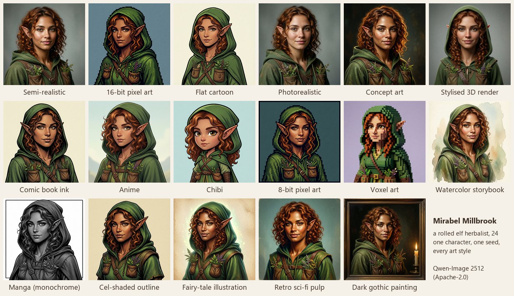
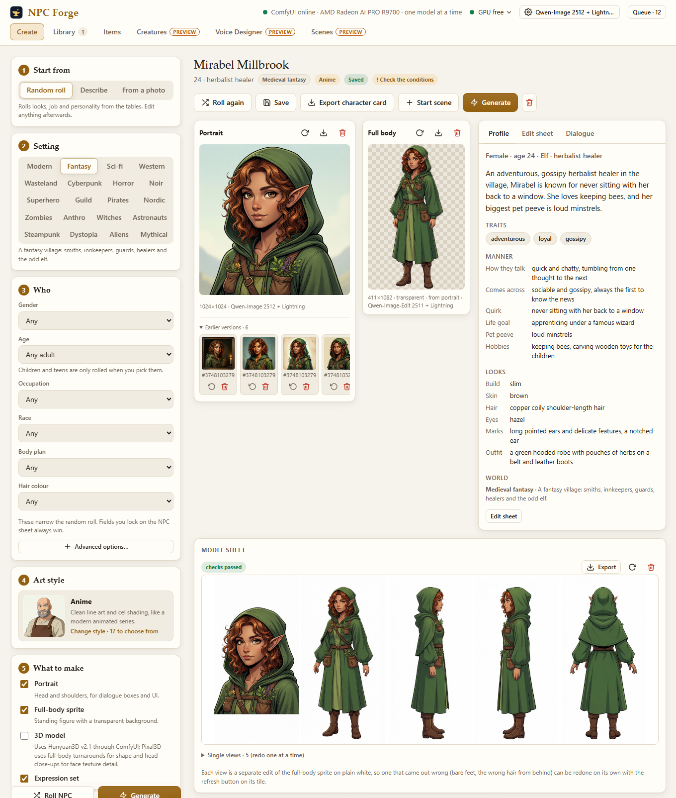

# Fel's NPC Forge

Characters for your game, made on your own PC. Roll a character, describe one in a sentence, or import a cast list, and NPC
Forge makes a data sheet with a personality, a portrait, expressions, a transparent full-body sprite, **walk cycles ready for
your engine**, a **model sheet** (a turnaround for 3D work), a **rigged 3D model**, and items for them to hold and wear. The
characters, their personalities and their dialogue need no graphics card; the pictures, animation and 3D models are drawn by
models running in your own ComfyUI. There is no cloud and nothing to train.

> **Part of Fel's Studio.** Four free apps that run on your own PC and work together. [Voice Slate](https://github.com/Fel101/fels-voice-slate)
> records voices with consent, [Voice Lab](https://github.com/Fel101/fels-voice-lab) designs and clones voices,
> [NPC Forge](https://github.com/Fel101/fels-npc-forge) makes characters for games, and [Altera](https://github.com/Fel101/Altera)
> lets you talk with them. Each one also works on its own.

[Quick start](#quick-start) · [What your PC can make](#what-your-pc-can-make) · [Gallery](docs/gallery.md) ·
[Documentation](docs/README.md) · [Responsible use](docs/responsible-use.md)



*One rolled character in all 17 art styles, drawn by Qwen-Image 2512 (Apache-2.0) on one PC. The
[gallery](docs/gallery.md) has her walk cycle, living portrait, 3D model and a Godot scene, with the model that made each.*

## What it makes

| | |
|---|---|
| **Characters** | 20 settings (modern, fantasy, sci-fi, Old West, cyberpunk, pirates, steampunk, mythical creatures…), 632 occupations with outfits, a personality and a bio, editable field by field with locks |
| **Pictures** | Portraits, expressions, a living portrait for chat apps, transparent full-body sprites and model sheets in 17 art styles, from pixel art to photorealistic |
| **Animation** | 4-direction walk cycles (and experimental run, attack, hurt, cast and fall clips), exported for Godot 4, Unity, Aseprite or a plain atlas |
| **3D** | A 3D model from the model sheet (Trellis2, Pixal3D or Hunyuan3D in ComfyUI), cleaned up and painted, with a skeleton and 85 animation clips (Blender) |
| **Items** | Weapons, armour, hats, shoes, bags and props as game-ready 3D models, and procedural glasses fitted to a face |
| **Dialogue and cards** | Dialogue packs as JSON, Ink or Yarn Spinner, cast packs, and character cards (PNG and CHARX) for chat apps |
| **Licences** | Every picture, model and voice is tagged with what its models allow: free for commercial use, with conditions, not cleared, or non-commercial |

**Preview** (marked in the app): the **Voice Designer** (a voice for every character, voiced dialogue and lip sync, through
Voice Lab), **Scenes** (two to six characters acting out a scene) and **Creatures** (non-humanoid creatures for a game). They
work, but have been checked on fewer characters than the rest: see [what has been checked](docs/status.md).



## What your PC can make

Characters with their personalities and backstories, dialogue packs, cast packs, scene scripts and the MCP server for AI
agents need no graphics card. Pictures, animation and 3D models need a graphics card and
[ComfyUI](https://github.com/comfyanonymous/ComfyUI), and what a card makes depends on its memory:

| Card | Makes | Model files |
|---|---|---|
| None, or no ComfyUI | Characters with their personalities, dialogue packs, cast packs and scene scripts | none |
| About 16 GB | Portraits with Z-Image Turbo, full-body sprites, 3D models with Hunyuan3D 2.1; expressions slowly (about 7 times as long) | 59.0 GB |
| About 24 GB | The same, and portraits with Qwen-Image 2512 | 81.1 GB |
| 32 GB | Everything: model sheets, walk cycles and other animation, and 3D models with Trellis2 and Pixal3D too | 90.4 GB |

The **Your PC** box on the Models card says which one yours is, and a new page starts with its models; you can still pick
any. **Set up ComfyUI** in the same box installs that size's model files after a yes. This was measured on an AMD Radeon AI
PRO R9700 (32 GB) under Windows 11 with ROCm, with the smaller cards made by holding part of it:
[hardware.md](docs/hardware.md) has the table.

Z-Image Turbo, which the 16 GB size starts with, pulls towards famous characters; its note in the Models card says so. The
built-in Mage-Flow engine runs on 16 GB at its usual speed, but Microsoft released it for research only, so read its
[licence note](docs/licences.md) before you use it for work you sell.

**One model at a time**, on by default, gives a picture the graphics card to itself: before NPC Forge draws, Voice Lab,
Altera, LM Studio and Ollama unload their models and wait. Turn it off if your card has room for everything
([models.md](docs/models.md#one-model-on-the-gpu-at-a-time)).

## Quick start

You need **Python 3.10 or newer**, and for pictures a graphics card and ComfyUI 0.36 or newer. Optional: **Blender 5**
(skeletons, clean-up and game models), **FFmpeg** (scene videos) and **Godot 4** (to try the exports).
[Requirements](docs/requirements.md) has the details.

1. Start ComfyUI and check it answers at `http://127.0.0.1:8188`. Its model files can wait: step 5 puts them in.
2. Get NPC Forge and install its few Python packages (Pillow, numpy, xatlas):
   ```bash
   git clone https://github.com/Fel101/fels-npc-forge.git
   cd fels-npc-forge
   setup.bat          # Windows; on Linux or macOS: ./setup.sh
   ```
3. Optional: copy `config.example.json` to `config.json` to change the ComfyUI address, the port or the default engines.
4. Start it: double-click `start.bat` (Windows), or run `python server.py --open`. The page opens at `http://127.0.0.1:8766`.
5. For pictures: open **Models and options** (top right) and press **Set up ComfyUI…** in the **Your PC** box. It picks
   your card's size, ticks what that card makes and, after a yes, downloads the model files into ComfyUI (59 GB for a
   16 GB card), with progress and Stop ([comfyui-setup.md](docs/comfyui-setup.md)). Characters and dialogue need none of it.
6. On the **Create** page press **Roll NPC**, tick what to make (a portrait is a good first try) and press **Generate**.
   The queue on the right shows each step; the finished character is in the **Library**.

The status line at the top of the page says whether ComfyUI answers and which model files it lacks.

**Updating:** *About* > **Check for updates** asks GitHub for a newer release (only when you press it), and **Update now**
shows what will change, updates NPC Forge and starts it again. `update.bat` (`./update.sh` on Linux or macOS) does the same
from a closed NPC Forge, and `update.bat --undo` puts back the version before. Your library, `config.json`, `local` folder and
`.venv` are never touched ([more](docs/requirements.md#updating)).

## Works with the other apps

Each app of Fel's Studio works on its own. Together:

- **Voice Lab gives your characters voices.** In the **Voice Designer**, pick one of its ready voices, describe a new one, or
  clone a recording you have permission to use; NPC Forge then voices the dialogue through it and times the lip sync itself
  ([voices.md](docs/voices.md)). A voice recorded with consent in **Voice Slate** reaches NPC Forge the same way, once Slate
  has sent it to Voice Lab.
- **Altera talks with them.** **Send to Altera** on a character hands it over as a CHARX card: portrait, sprite, expressions,
  living portrait, character sheet and voice ([character cards](docs/characters.md#character-cards)). Other chat apps that
  read Character Card V3 or V2 take the same cards from **Export character card**.
- **They share one graphics card.** The GPU light in the header shows which app holds the card and what for, and **One model
  at a time** decides whether a picture waits for an empty card ([models.md](docs/models.md#one-model-on-the-gpu-at-a-time)).
- **AI agents and scripts.** Claude Code, Codex, opencode and other MCP clients can make characters and export them for a
  game through NPC Forge's MCP server ([agents.md](docs/agents.md)); scripts and game tools can use the
  [HTTP API](docs/api.md) ([game-clients.md](docs/game-clients.md)).

The apps find each other on this computer through Fel's Studio's address files and talk over their local HTTP APIs; none reads
another's folders. Voice Lab uses port 8765, NPC Forge 8766 and Altera 8767.

## Licences, in short

- NPC Forge's own code is MIT.
- Every model has its own licence, and NPC Forge shows it: a badge after each model's name, a note under the chosen model,
  a badge on every character (the worst rating of the models that made it), and a **Commercial use** filter in the Library.
- The default engines, Qwen-Image 2512 and Qwen-Image-Edit 2511, and Z-Image Turbo are Apache-2.0: fine for work you sell.
  Qwen Image 2.1 is non-commercial. The built-in Mage-Flow is **not cleared** (MIT, but Microsoft says research only).
  Hunyuan3D, Pixal3D and Trellis2 carry conditions.
- Every picture and 3D model says inside it whether AI made it, and with which models.
- [licences.md](docs/licences.md) has every model and how a rating is worked out, and [NOTICE.md](NOTICE.md) the notices.
  It is what each model's own page says, not legal advice.

Please read [Responsible use](docs/responsible-use.md): keep characters fictional, use voices and photos only with
permission, and keep the AI labels.

## Documentation

[The documentation index](docs/README.md) lists every page. The ones most people need:

- **Making things:** [characters](docs/characters.md), [models](docs/models.md), [animation and model sheets](docs/animation-and-sheets.md),
  [3D models](docs/3d-models.md), [items](docs/items.md), [voices](docs/voices.md), [scenes](docs/scene-studio.md),
  [creatures](docs/creatures.md)
- **Setting up:** [requirements](docs/requirements.md), [Set up ComfyUI](docs/comfyui-setup.md),
  [what your PC can make](docs/hardware.md), [troubleshooting](docs/troubleshooting.md)
- **For developers:** [HTTP API](docs/api.md), [AI agents](docs/agents.md), [game clients](docs/game-clients.md),
  [customising](docs/customising.md), [files and layout](docs/files.md), [network security](docs/security.md),
  [CONTRIBUTING.md](CONTRIBUTING.md)
- **What has been checked:** [status](docs/status.md), and the [changelog](CHANGELOG.md)

Security problems: please report them privately ([SECURITY.md](SECURITY.md)).

## Licence and credits

Code: MIT, copyright 2026 Pete Hudson, see [LICENSE](LICENSE). Model, ComfyUI and dependency notices, the research-use
statement and the citation are in [NOTICE.md](NOTICE.md). Mage-Flow is by Microsoft Research; please cite it when you publish
results. The animation library is [Quaternius' Universal Animation Library](https://quaternius.com/packs/universalanimationlibrary.html) (CC0).
