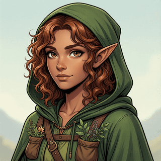
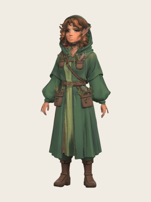
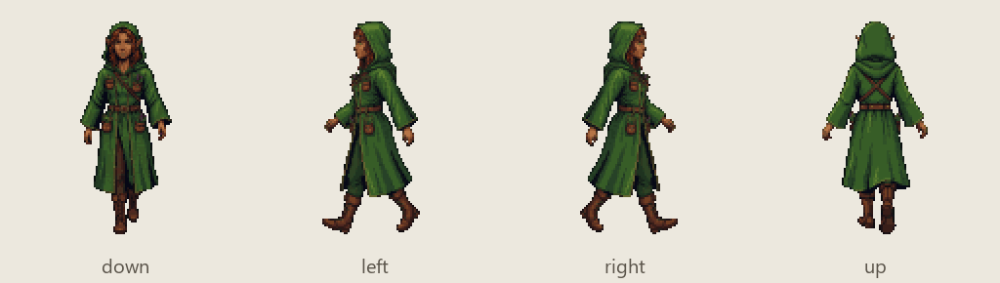

# Gallery

Everything on this page was made by NPC Forge on one PC (an AMD Radeon AI PRO R9700 with 32 GB), from one rolled
character: nobody real, and no picture drawn from a photo. Each picture says which model made it. All of them use models
whose licences allow commercial use, except the 3D model, whose licence adds conditions ([licences.md](licences.md)).

The pictures here are made smaller for this page, and they do not carry the AI labels that Forge writes into its own files
([responsible-use.md](responsible-use.md#label-what-you-make)), so this page says it instead: they were all made with AI
models.

## One character in every art style

Mirabel Millbrook was rolled in the fantasy setting: an elf herbalist healer of 24, with copper coily hair and a green
hooded robe with pouches of herbs. Her portrait was then drawn once in each of the 17 styles, with the same seed, by
**Qwen-Image 2512** with its Lightning LoRA (Apache-2.0). Each took about 15 seconds once the model was loaded.

## A living portrait

The living portrait is the portrait with only the eyes or the mouth changed, so nothing else flickers. Its frames are
edits of the anime portrait by **Qwen-Image-Edit 2511** with its Lightning LoRA (Apache-2.0): ten expressions in under six
minutes. A chat app shows them while a line plays; here the mouth follows a made-up rhythm, because a GIF has no sound.
See [the living portrait](characters.md#living-portrait).

## A model sheet and a 3D model

The model sheet (her front, both sides and her back, each an edit of the full-body sprite by Qwen-Image-Edit 2511) took
under two minutes. **Pixal3D** made the textured 3D model from those views in 26 minutes, at its Medium setting. Pixal3D
is MIT, but it reads Meta's DINOv3, whose licence adds conditions, so Forge rates the model "Allowed, with conditions".
The turn was rendered in Blender from the GLB as Forge saved it, without any clean-up.

## A walk cycle

The walk is in 16-bit pixel art. Her portrait and full-body sprite were drawn again in that style, then a four-frame walk
facing down, right and up, every frame an edit of the sprite by **Qwen-Image-Edit 2511** (Apache-2.0); the left walk is
the right one mirrored. The walk took six minutes. The GIF shows the frames of the Godot export below (128 pixels, shown
twice the size) at the clip's own five frames a second.

Forge flagged the side view, and it is right: in pixel art a walk is drawn from words rather than from a posed figure,
and her feet hardly come together between steps (stride contrast 1.1; Forge flags anything under 1.35), so seen from the side
she glides a little. [Animation](animation.md#which-styles-get-the-puppet) explains why pixel art is drawn from words.

## In Godot

The same walk, exported with the **Godot 4** preset (a PNG strip for each direction and a SpriteFrames `.tres` with
`walk_down`, `walk_left`, `walk_right` and `walk_up`), dropped into an empty Godot 4.7 project. The only code is a
short script that walks her round the path and plays the animation that faces the way she goes, and a second one that
draws the garden. Godot's Movie Maker recorded it at ten frames a second.

The export is 128 pixels with 48 colours (`colors=48` on the export link). At the default 24 her skin came out olive:
pixel-art frames share one palette for the whole clip, so the colours never shimmer, and her green robe took most of it.

## The page

Mirabel open in the Library, in the anime style the living portrait and the 3D model were made from: the portrait by
Qwen-Image 2512, the sprite and the model sheet by Qwen-Image-Edit 2511.

## How these were made

- A copy of NPC Forge with a library of its own, on the same PC as ComfyUI 0.37, through the [HTTP API](api.md): one
  saved character, then one request for each picture or set, as the page sends them.
- One model on the card at a time, standard quality throughout. No picture was touched up afterwards; FFmpeg put the GIFs
  together and Blender rendered the turn.
- What did not work the first time:
  - The walk was first drawn in the anime style, from a posed figure. In the stride frames her robe turned into leggings,
    and Forge flagged frames that missed their pose, so the walk was drawn again in pixel art.
  - The pixel walk was re-rolled once, to try for a better side view. The re-roll came out worse (the front view's legs
    barely moved, and bits of the background stayed at her feet), so the first walk is the one shown.
  - Once, ComfyUI stopped answering while a reference view was drawing. Retry ran the job again from that step and kept
    everything already drawn.
  - The living portrait's blink and talking frames first showed nothing. Qwen-Image-Edit 2511 returns an expression as the
    middle 992 pixels of the 1,024-pixel portrait, and Forge stretched it back, which moved her eyes and mouth by up to
    16 pixels. Forge now puts such a frame back in the middle; the living portrait was assembled again from the same
    edits, with nothing drawn again.
  - The export's default palette, as above.

[Back to the documentation](README.md)
