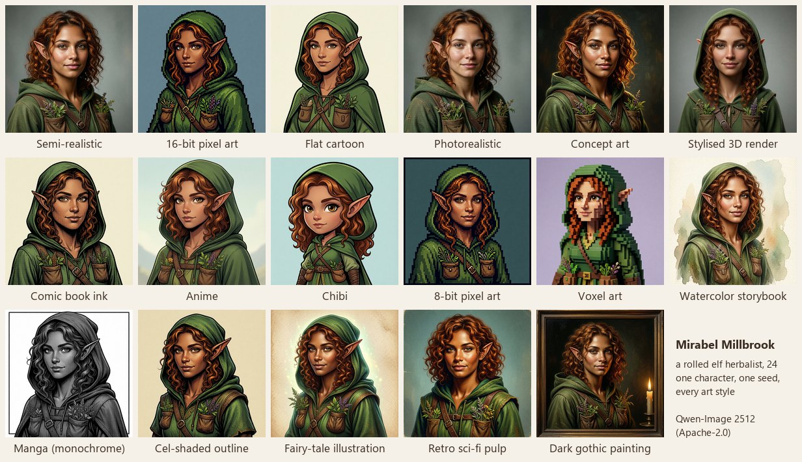
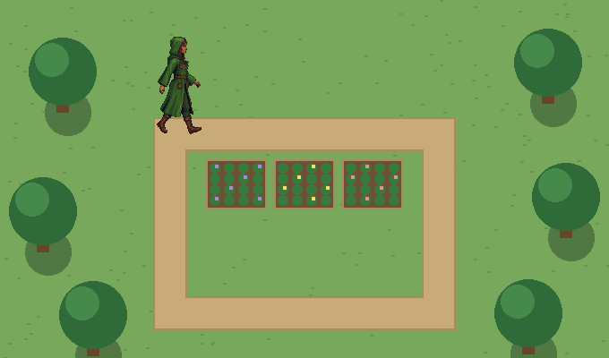
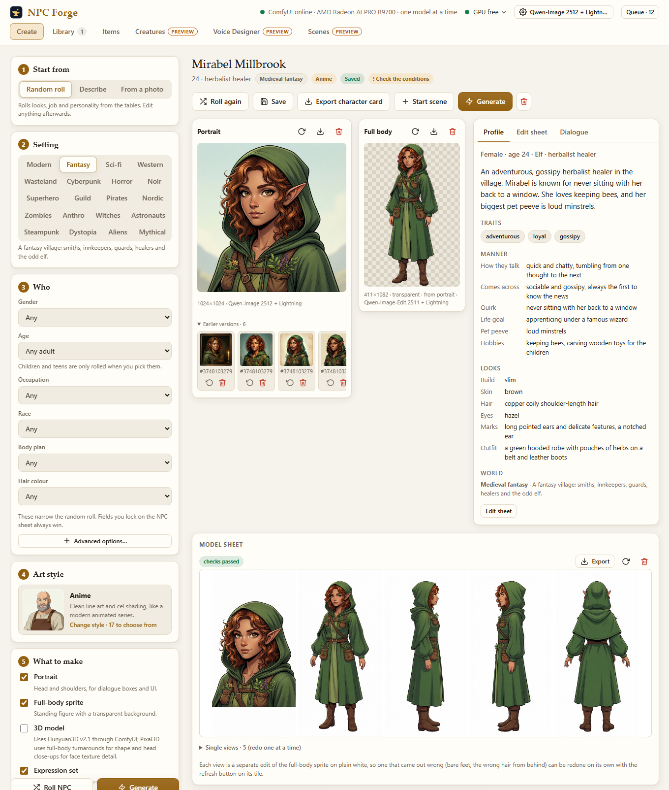
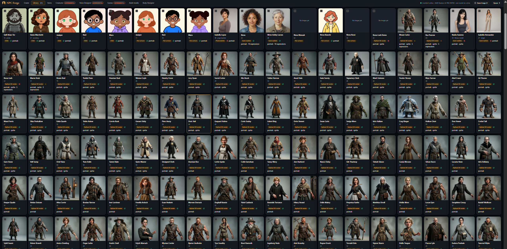
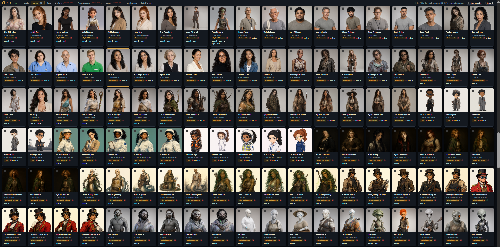
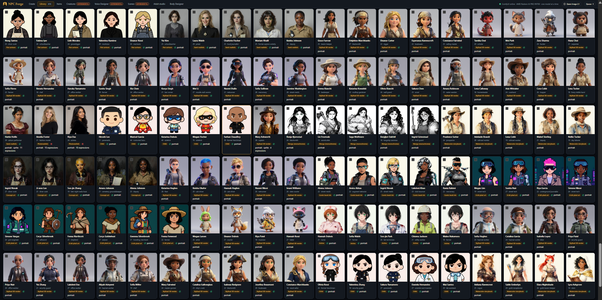

# Gallery

The Mirabel demos were made by NPC Forge on one PC (an AMD Radeon AI PRO R9700 with 32 GB) from one rolled fictional
character. Each demo names the model that made it. The models used in these demos allow commercial use, with additional
conditions for the 3D model ([licences.md](licences.md)).

The demo images were resized for this page. They were made with AI models, as labelled in the original Forge files
([responsible-use.md](responsible-use.md#label-what-you-make)). The [Library screenshots](#the-library) show a larger
collection from a separate run of the app.

## One character in every art style

Mirabel Millbrook was rolled in the fantasy setting: an elf herbalist healer of 24, with copper coily hair and a green
hooded robe with pouches of herbs. Her portrait was then drawn once in each of the 17 styles, with the same seed, by
**Qwen-Image 2512** with its Lightning LoRA (Apache-2.0). Each took about 15 seconds once the model was loaded.

## A living portrait

The living portrait is the portrait with only the eyes or the mouth changed, so nothing else flickers. Its frames are
edits of the anime portrait by **Qwen-Image-Edit 2511** with its Lightning LoRA (Apache-2.0): ten expressions in under six
minutes. A chat app shows them while a line plays; here the mouth follows a made-up rhythm, because a GIF has no sound.
See [the living portrait](characters.md#living-portrait).

## A model sheet and a 3D model

The model sheet (her front, both sides and her back, each an edit of the full-body sprite by Qwen-Image-Edit 2511) took
under two minutes. **Pixal3D** made the textured 3D model from those views in 26 minutes, at its Medium setting. Pixal3D
is MIT, but it reads Meta's DINOv3, whose licence adds conditions, so Forge rates the model "Allowed, with conditions".
The turn was rendered in Blender from the GLB as Forge saved it, without any clean-up.

## A walk cycle

The walk is in 16-bit pixel art. Her portrait and full-body sprite were drawn again in that style, followed by a four-frame
walk facing down, right and up using **Qwen-Image-Edit 2511** (Apache-2.0). Forge mirrors the right walk for the left view.
The GIF shows the frames of the Godot export below (128 pixels, shown twice the size) at the clip's own five frames a second.

Forge flagged the original side view because Mirabel kept her feet apart through the whole cycle. The generator kept her
landing poses and redrew both passing poses with one boot planted and the other lifted. Stride contrast in the exported side
view rose from 1.12 to 3.30. Forge flags values under 1.35. See [how Forge draws a walk](animation.md#which-styles-get-the-puppet).

## In Godot

The same walk, exported with the **Godot 4** preset (a PNG strip for each direction and a SpriteFrames `.tres` with
`walk_down`, `walk_left`, `walk_right` and `walk_up`), dropped into an empty Godot 4.7 project. The only code is a
short script that walks her round the path and plays the animation that faces the way she goes, and a second one that
draws the garden. Godot's Movie Maker recorded it at ten frames a second.

The export uses 128-pixel frames and 48 colours (`colors=48` on the export link). All the pixel-art frames share one
palette so colours stay consistent through the clip.

## The page

Mirabel open in the Library, in the anime style the living portrait and the 3D model were made from: the portrait by
Qwen-Image 2512, the sprite and the model sheet by Qwen-Image-Edit 2511.

## The Library

Three screenshots of the NPC Forge Library on November 22, 2026. The largest collection shown has 876 character entries.
Each card shows its style, available assets and licence status.

## How these were made

- The original demos ran in a copy of NPC Forge with its own library and ComfyUI 0.37, using the [HTTP API](api.md).
  The two passing poses in the updated walk were redrawn with ComfyUI 0.46.2 on the same PC.
- One model on the card at a time, standard quality throughout. No picture was touched up afterwards; FFmpeg put the GIFs
  together and Blender rendered the turn.
- What did not work the first time:
  - The walk was first drawn in the anime style, from a posed figure. In the stride frames her robe turned into leggings,
    and Forge flagged frames that missed their pose, so the walk was drawn again in pixel art.
  - The first pixel walk slid in profile. A full re-roll also weakened the front view and left bits of background at her
    feet. The current gallery uses the original walk with two passing poses redrawn by Forge.
  - Once, ComfyUI stopped answering while a reference view was drawing. Retry ran the job again from that step and kept
    everything already drawn.
  - The living portrait's blink and talking frames first showed nothing. Qwen-Image-Edit 2511 returns an expression as the
    middle 992 pixels of the 1,024-pixel portrait, and Forge stretched it back, which moved her eyes and mouth by up to
    16 pixels. Forge now puts such a frame back in the middle; the living portrait was assembled again from the same
    edits, with nothing drawn again.

[Back to the documentation](README.md)
